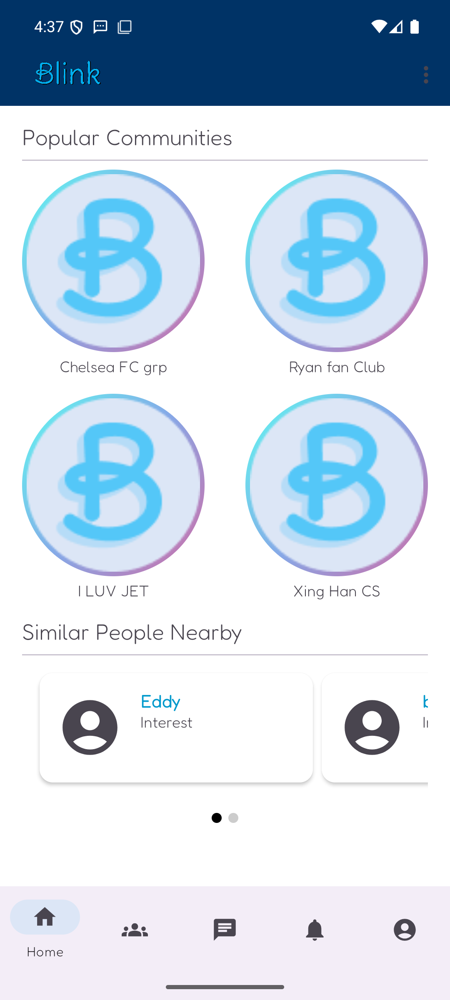
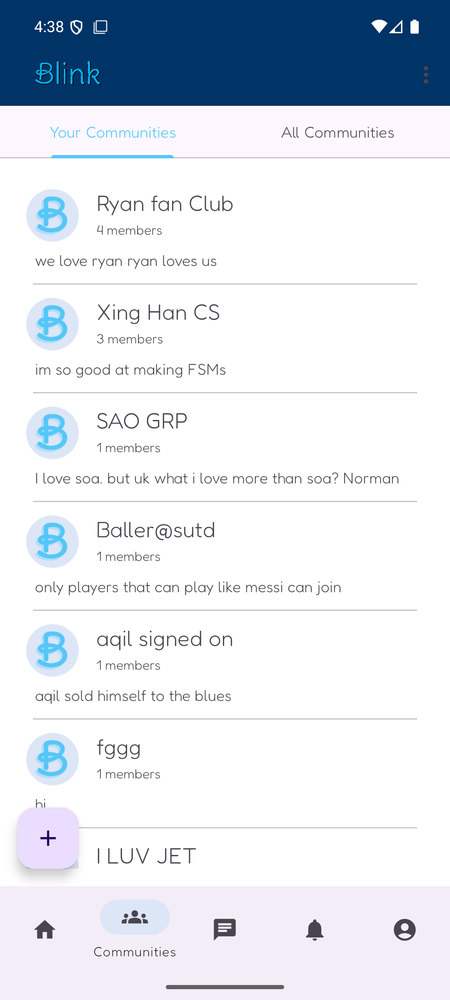
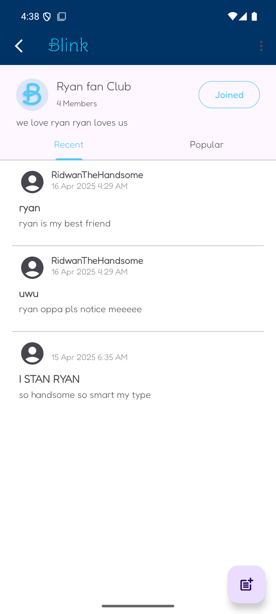
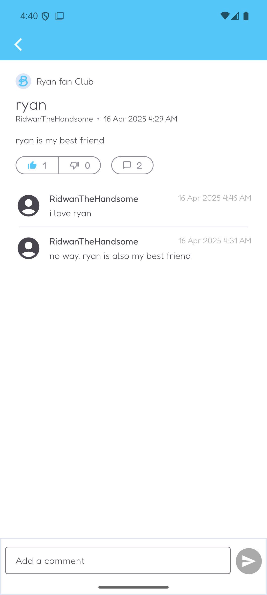
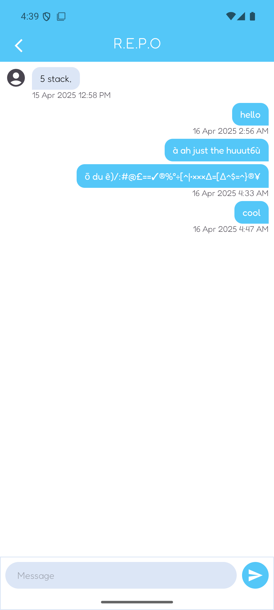
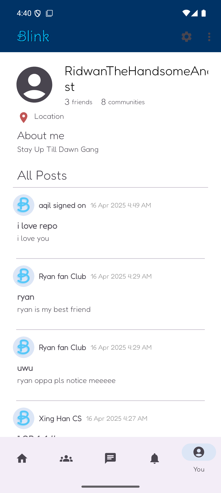
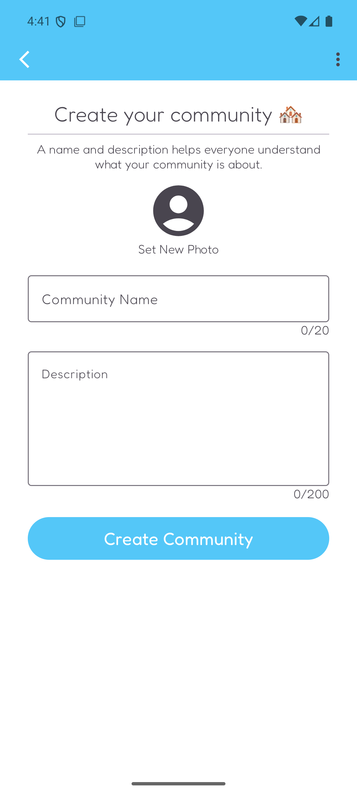
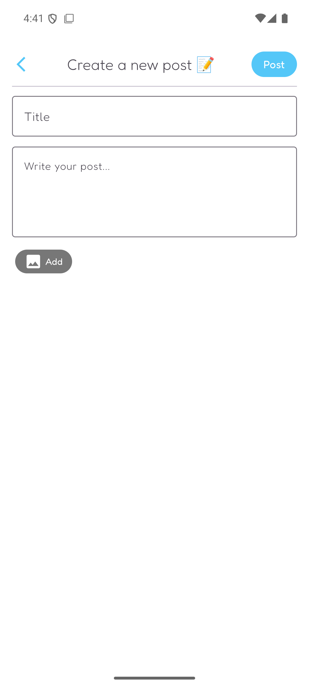
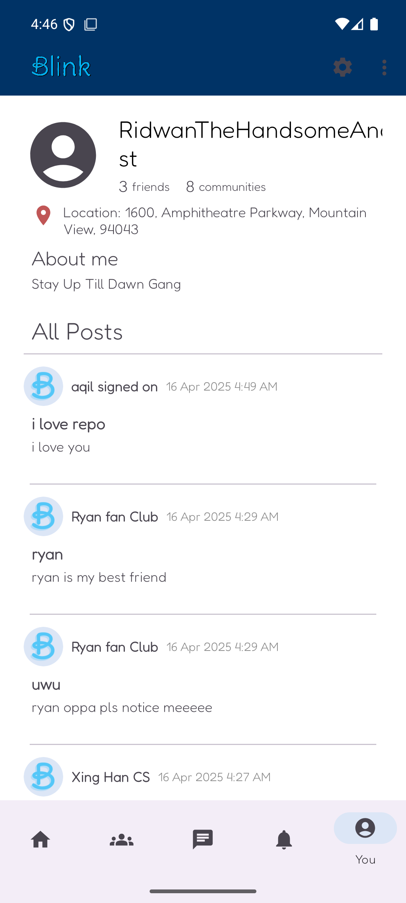

# BLINK

BLINK is an Android social networking application for discovering nearby users, joining interest-based communities, publishing posts, and communicating through direct and group chats.

## Features

- Discover popular communities and nearby users
- Create, browse, and join communities
- Publish posts with optional images
- Like, dislike, and comment on community posts
- Send direct and group messages
- Receive in-app notifications
- Maintain a personal profile and location-based presence

## Screenshots

| Home discovery | Community browser | Community feed |
| --- | --- | --- |
|  |  |  |

| Post engagement | Direct messaging | Profile |
| --- | --- | --- |
|  |  |  |

| Create a community | Create a post | Location-enabled profile |
| --- | --- | --- |
|  |  |  |

The location shown in the final screenshot is the Android emulator's default simulated location.

## Technology

- Java 11
- Android SDK 35 (minimum SDK 24)
- Firebase Authentication, Cloud Firestore, Storage, Messaging, and Analytics
- Material Design components
- Glide for image loading
- Google Play Services Location
- MVVM-oriented view models and repository-style managers

## Getting started

1. Clone the repository.
2. Open the project in Android Studio.
3. Configure an Android emulator or connect a physical Android device.
4. Ensure the required Firebase configuration is available at `app/google-services.json`.
5. Build and run the `app` configuration.

From the command line on Windows:

```powershell
.\gradlew.bat :app:assembleDebug
```

The debug APK is generated under `app/build/outputs/apk/debug/`.

## Project structure

```text
app/src/main/java/com/example/infosys/
|-- activities/   # Full-screen application flows
|-- fragments/    # Main navigation destinations
|-- adapters/     # RecyclerView and ViewPager adapters
|-- managers/     # Authentication, chat, and data operations
|-- model/        # Application data models
|-- services/     # Location and notification services
|-- utils/        # Shared Firebase and Android helpers
`-- viewmodels/   # UI-facing state management
```
